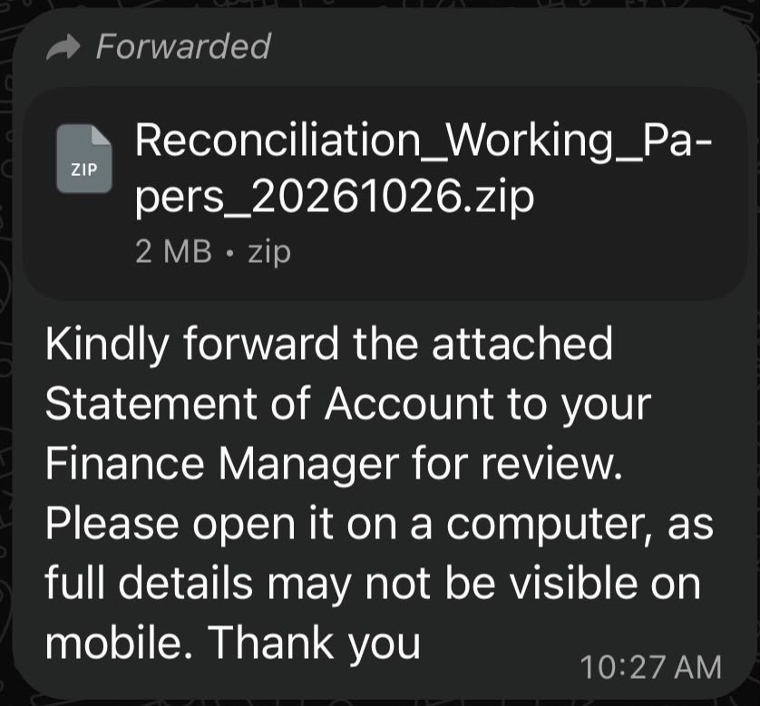
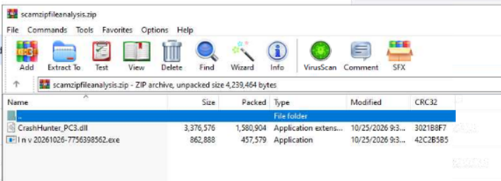
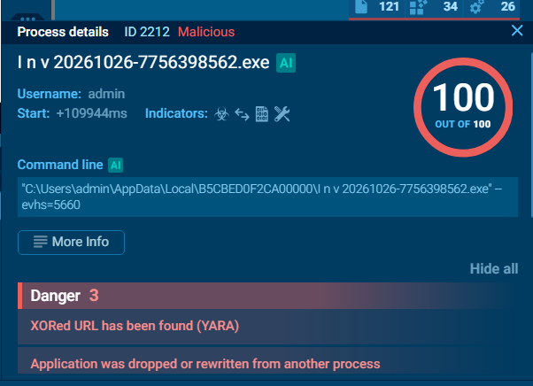
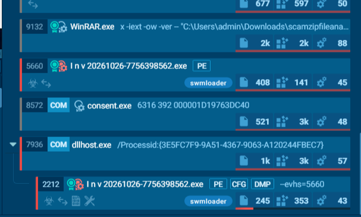

# WhatsApp ZIP malware analysis

Dynamic analysis (ANY.RUN sandbox) of two malicious ZIP files delivered over WhatsApp to finance and admin staff. Both push the victim to "open it on a computer", because phones cannot run Windows executables.

> Defensive research and awareness only. No malware samples are stored in this repo. Indicators are defanged.

## Jump to a case

| | Lure | Technique | Verdict |
|---|------|-----------|---------|
| [**Case 1**](#case-1-statement-of-account-zip-swmloader) | `Reconciliation_Working_Papers_20261026.zip` ("Statement of Account") | EXE + DLL sideloading, swmloader, COM `dllhost` relaunch | 100/100 malicious |
| [**Case 2**](#case-2-fake-pdf-zip-that-installs-a-manageengine-agent) | `PDF_2K1RQW_20261023110727.zip` (Malay: "Tolong buka komputer dan semak ya") | VHD mount, DLL sideloading, silent install of ManageEngine UEMS agent (RMM abuse) | 26 malicious / 34 suspicious processes |

Also on this page: [Common pattern](#common-pattern) | [Detection ideas](#detection-and-hunting-ideas) | [If you ran it](#if-you-ran-it)

---

## Case 1: Statement of Account ZIP (swmloader)

**Lure:** `Reconciliation_Working_Papers_20261026.zip` (2 MB), forwarded on WhatsApp: "forward the attached Statement of Account to your Finance Manager... open it on a computer."

### What is inside the ZIP

- `I n v 20261026-7756398562.exe`: fake invoice (odd spaces in the name)
- `CrashHunter_PC3.dll`: sideloaded DLL (~3 MB)

### What it does
1. The EXE loads the DLL from the same folder (**DLL sideloading**).
2. Tagged `swmloader`, `loader`, `fingerprinting`, `arch-exec`. Score **100/100**.
3. A COM `dllhost.exe /Processid:{3E5FC7F9-...}` relaunches the EXE from `AppData\Local\B5CBED0F2CA00000\` with `--evhs=<PID>`.
4. YARA: XOR-obfuscated URL found; application dropped/rewritten from another process.
5. Microsoft and DigiCert traffic in the capture is background Windows noise.

### Case 1 indicators
| Type | Value |
|---|---|
| ZIP | `Reconciliation_Working_Papers_20261026.zip` |
| EXE | `I n v 20261026-7756398562.exe` |
| DLL | `CrashHunter_PC3.dll` |
| Path | `%LOCALAPPDATA%\B5CBED0F2CA00000\` |
| Command line | `--evhs=<PID>` |

LinkedIn post: [posts/case-01-linkedin-post.md](posts/case-01-linkedin-post.md)

[Back to top](#whatsapp-zip-malware-analysis)

---

## Case 2: Fake PDF ZIP that installs a ManageEngine agent

**Lure:** `PDF_2K1RQW_20261023110727.zip` (574 KB) with the Malay message "Tolong buka komputer dan semak ya" (please open on a computer and check).

### The attack chain
**1. VHD trick.** The ZIP holds a `.vhd` virtual disk (~8 MB). Double-clicking mounts it as a drive.

**2. Payload.** The mounted drive holds `PDF_2K1RQW_...exe` and `CRclIENt.DLL` (32 KB), loaded by DLL sideloading. ANY.RUN flagged "loading modules from mounted disk drive" and an XOR-obfuscated URL (YARA).

**3. C2 config (decrypted).** Two URLs on a lookalike "download" domain:
- `hxxps://www[.]fafadownload[.]com/beacon[.]php`
- `hxxps://ccc[.]fafadownload[.]com/plapdla[.]dat`

**4. Silent install.** `tar.exe -xf C:\ProgramData\Office89bd\w.zip`, then a quiet `msiexec /i ...UEMSAgent.msi`. This is the **ManageEngine UEMS agent**, a legitimate IT-admin (RMM) tool, which makes antivirus less likely to complain.

**5. What the agent did on the PC.**
- Raised privileges from medium to High/System
- Changed system certificates (lsass, msiexec)
- Registered as Windows services
- Ran `systeminfo` and software inventory
- Enumerated USB devices and software usage
- Scanned for patches
- Dropped drivers and EDR-style components
- Forced a Group Policy refresh
- YARA flagged screenshot capability

**Stats:** 367 processes, 204 monitored, **26 malicious**, **34 suspicious**. Tags: `fingerprinting`, `manageengine`, `rmm-tool`, `remote`, `arch-exec`.

The report does not show which server the agent registered to, so remote control is the risk, not a confirmed observation.

### Case 2 indicators
| Type | Value |
|---|---|
| ZIP | `PDF_2K1RQW_20261023110727.zip` |
| VHD | `PDF_2K1RQW_20261023110727.vhd` |
| EXE | `PDF_2K1RQW_20261023110727.exe` |
| DLL | `CRclIENt.DLL` |
| C2 | `hxxps://www[.]fafadownload[.]com/beacon[.]php` |
| Next stage | `hxxps://ccc[.]fafadownload[.]com/plapdla[.]dat` |
| Drop folder | `C:\ProgramData\Office89bd\` (`w.zip`, `UEMSAgent.msi`) |
| SHA256 | `8DC7D72C69920332E171FE87057CCC7C8CC23CECEC850C36EA56F94F1E189214` |

Full sandbox report: [ANY.RUN](https://any.run/report/8dc7d72c69920332e171fe87057ccc7c8cc23cecec850c36ea56f94f1e189214/cbf53acf-8692-4605-a6aa-ad0603e7c60b)

LinkedIn post: [posts/case-02-linkedin-post.md](posts/case-02-linkedin-post.md)

[Back to top](#whatsapp-zip-malware-analysis)

---

## Common pattern
1. A forwarded WhatsApp message with a ZIP and an urgent "open on a computer" request.
2. A fake document name (`Inv ...exe`, `PDF_...exe`) next to a malicious DLL.
3. DLL sideloading loads the DLL when the EXE is run.
4. Obfuscated (XOR) C2 URL, then a second stage or a legitimate remote-management tool.
5. Possible spread: a logged-in WhatsApp Web session could be abused to send the same lure to contacts. This is a risk, not something the sandbox proved.

## Detection and hunting ideas
- EXE launched from a mounted `.vhd`/`.iso` drive or an extracted ZIP folder that loads an unsigned DLL from its own folder.
- `dllhost.exe /Processid:{...}` spawning a user-writable-path EXE with `--evhs=`.
- `tar.exe -xf ...\ProgramData\...zip` followed by a quiet `msiexec /i ...msi`.
- Unexpected ManageEngine UEMS agent (`dcagentservice.exe`, `uesAgentService.exe`, `meaap.exe`) on hosts that do not use ManageEngine.
- Policy: block mounting of `.vhd`/`.iso` for standard users, enforce AppLocker/WDAC on user-writable paths, show file extensions.

## If you ran it
Disconnect from the network, log out of WhatsApp Web, change passwords from a clean device, and contact IT/security.

## More files
- [iocs/iocs.csv](iocs/iocs.csv) and [iocs/reports.txt](iocs/reports.txt)
- [docs/index.html](docs/index.html): ready-to-post page with images

## Disclaimer
ManageEngine is legitimate software. Case 2 describes an attacker abusing it, not a flaw in the vendor's product.
