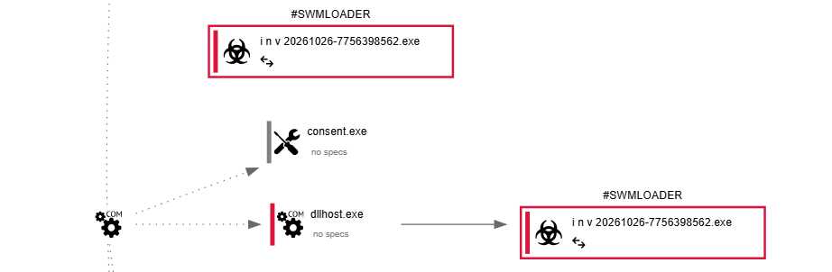
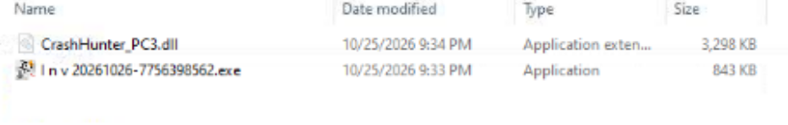
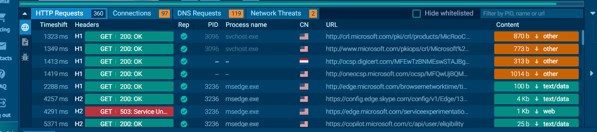

# Case 01: Statement of Account ZIP (swmloader)

**Lure:** `Reconciliation_Working_Papers_20261026.zip` (2 MB), forwarded on WhatsApp: "forward the attached Statement of Account to your Finance Manager... open it on a computer."

## Contents

- `I n v 20261026-7756398562.exe` (fake invoice, odd spaces in the name)
- `CrashHunter_PC3.dll` (~3 MB)

## Behaviour
1. The EXE loads the DLL from the same folder (DLL sideloading).
2. Tagged `swmloader`, `loader`, `fingerprinting`, `arch-exec`. Score 100/100.
3. A COM `dllhost.exe /Processid:{3E5FC7F9-...}` relaunches the EXE from `AppData\Local\B5CBED0F2CA00000\` with `--evhs=<PID>`.
4. YARA: XOR-obfuscated URL found; application dropped/rewritten from another process.
5. Microsoft/DigiCert traffic in the capture is background Windows noise.

Before publishing screenshots publicly, check they do not expose your own username or paths.
