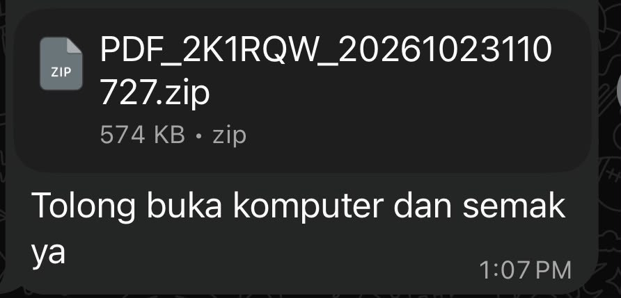
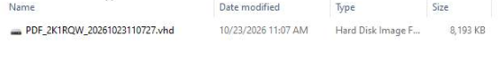
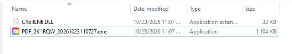
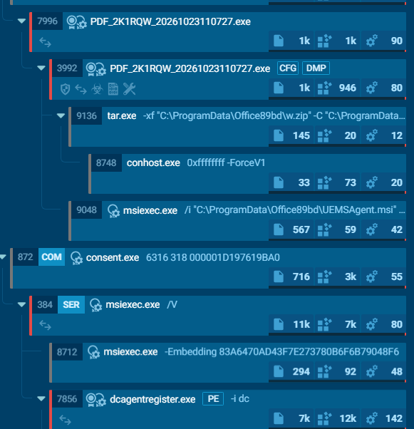
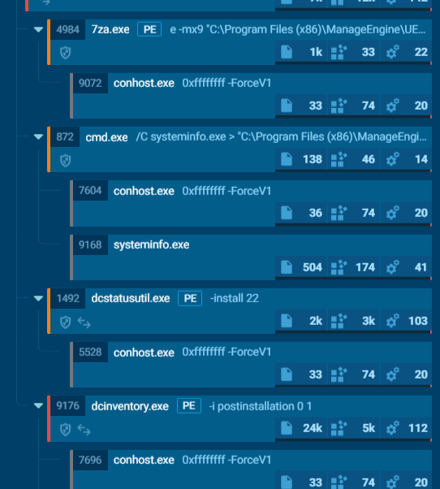
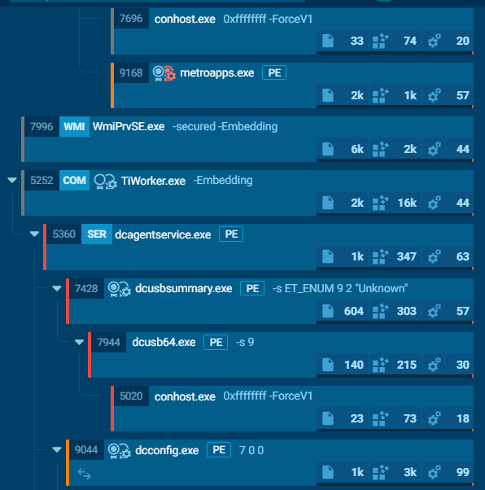
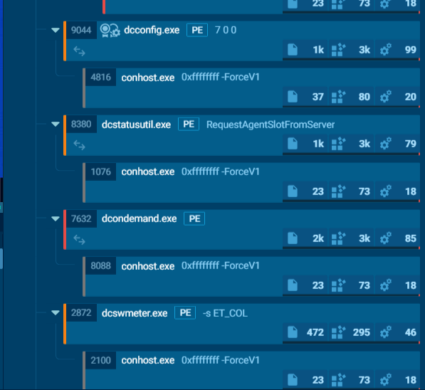

# Case 02: Fake PDF ZIP that installs a ManageEngine agent

**Lure:** `PDF_2K1RQW_20261023110727.zip` (574 KB) with the Malay message "Tolong buka komputer dan semak ya" (please open on a computer and check).

## Chain
1. **VHD:** the ZIP holds a `.vhd` (~8 MB). Double-clicking mounts it as a drive.
   
2. **Payload:** the drive holds `PDF_2K1RQW_...exe` and `CRclIENt.DLL` (32 KB), loaded by sideloading. ANY.RUN: "loading modules from mounted disk drive", XOR-obfuscated URL (YARA).
   
3. **C2 config (decrypted):** `hxxps://www[.]fafadownload[.]com/beacon[.]php` and `hxxps://ccc[.]fafadownload[.]com/plapdla[.]dat`.
4. **Silent install:** `tar.exe -xf C:\ProgramData\Office89bd\w.zip`, then `msiexec /i ...UEMSAgent.msi` (quiet). This is the ManageEngine UEMS agent, a legitimate RMM tool.
   
5. **Agent activity:** privilege elevation (medium to High/System), certificate changes (lsass, msiexec), Windows services, `systeminfo`, software inventory, USB enumeration, software metering, patch scan, driver and EDR-style components, `gpupdate`, YARA screenshot capability.
   
   
   

**Stats:** 367 processes, 204 monitored, 26 malicious, 34 suspicious. Tags: `fingerprinting`, `manageengine`, `rmm-tool`, `remote`, `arch-exec`.

The report does not show which server the agent registered to, so remote control is the risk, not a confirmed observation.
